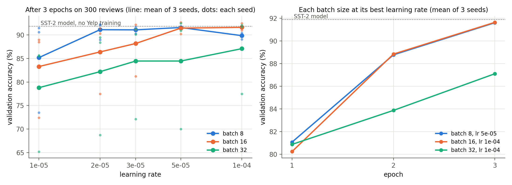
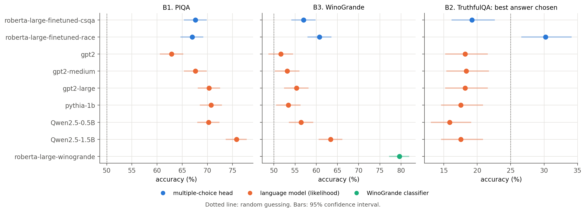
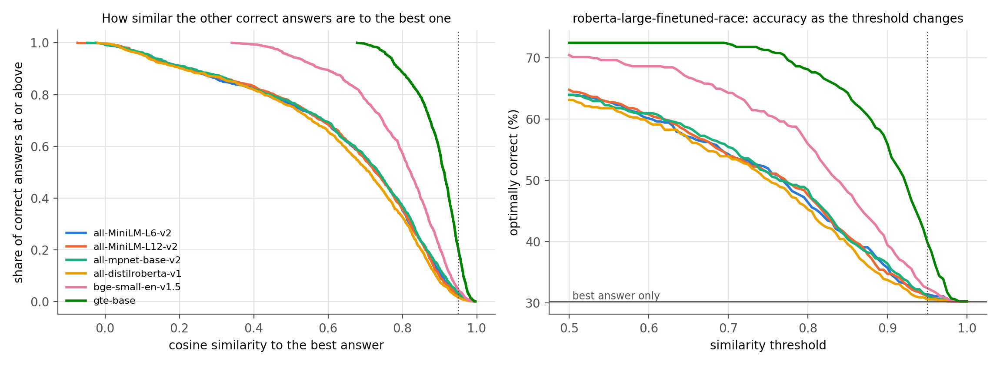

# Pretrained Transformers: Fine-Tuning on 300 Reviews and Zero-Shot Reasoning


Lab 2 of a university course on neural networks and deep learning (coursework, 2024-2025). It covers two ways of using pretrained language models:

- **Part A, fine-tuning:** DistilBERT learns to tell positive from negative Yelp reviews from only 300 labelled examples. A search over learning rate and batch size, with 3 seeds each, shows how these settings affect the result.
- **Part B, zero-shot use:** nine pretrained models from the Hugging Face Hub are compared on three reasoning benchmarks (PIQA, TruthfulQA, WinoGrande) with no training at all. Each benchmark is rewritten as a task the models already know: multiple choice, text likelihood, or sentence-pair classification.

Every choice is made on validation data; test data is used once, for the final number. The whole notebook runs in about 35 minutes on a free Kaggle GPU.

## Results at a glance

| Task | Result |
|---|---|
| Yelp sentiment, DistilBERT fine-tuned on 300 reviews | **90.1 %** test accuracy (a ready-made movie-review model gets 90.8 %) |
| PIQA, physical common sense, best model without training | **75.8 %** (Qwen2.5-1.5B; chance is 50 %) |
| WinoGrande, pronoun resolution | **79.6 %** (RoBERTa-large trained on WinoGrande); 63.4 % without task training |
| TruthfulQA, best answer chosen | **30.2 %** (RoBERTa-large trained on RACE; chance is 25 %) |

## Table of contents

- [The task](#the-task)
- [What I did](#what-i-did)
- [Results](#results)
- [Findings](#findings)
- [Repository structure](#repository-structure)
- [Getting started](#getting-started)
- [References](#references)
- [Sources and credits](#sources-and-credits)
- [License](#license)

## The task

Language models are trained in two stages. *Pre-training* teaches a model the language from huge amounts of unlabelled text, and is very expensive. *Fine-tuning* then adapts the pretrained model to one task with a small labelled dataset.

**Part A, fine-tuning.** Fine-tune a pretrained model that has a classification head (here DistilBERT, a smaller and faster version of BERT) to label **Yelp** reviews as negative (1–2 stars) or positive (3–4 stars). Use only 300 balanced training reviews, try different learning rates and batch sizes, and explain how they affect the result.

**Part B, pretrained models on new tasks, with no training.** Reduce each problem to a standard one (multiple choice, text likelihood, sentence-pair classification) and compare suitable models from the Hugging Face Hub:

- **B1. PIQA:** physical common sense. Pick the better of two solutions to a goal; for example, to carry melted butter, should you pour it onto a plate or into a jar?
- **B2. TruthfulQA:** questions that people often answer wrongly because of common misconceptions. Each question has four candidate answers: the best answer, two other correct answers and one incorrect answer. A prediction counts as *optimally correct* if it picks the best answer. It also counts if it picks another correct answer whose meaning is almost the same as the best one: the cosine similarity of their sentence-transformer embeddings must be at least 0.95. Compare at least 6 sentence-similarity models.
- **B3. WinoGrande:** fill a blank with one of two words that both appear in the sentence. For example, in "The trophy doesn't fit in the suitcase because the _ is too small", the answer is suitcase, not trophy.

## What I did

**Part A**

| Setting | Value |
|---|---|
| Data | 300 training and 1,000 validation reviews, disjoint and both from the training split, plus 2,000 test reviews from the test split; every set is half positive, half negative |
| Search | 5 learning rates (1e-5 to 1e-4) × 3 batch sizes (8, 16, 32) × 3 seeds = 45 fine-tunings of 3 epochs, each starting from the same pretrained weights |
| Optimiser | AdamW with weight decay 0.01, linear warm-up over the first 10 % of steps then linear decay to 0, gradient clipping 1.0, mixed precision |
| Selection | the setting with the best mean validation accuracy; its test accuracy is reported once |
| Baseline | a ready-made DistilBERT fine-tuned on SST-2 movie reviews, which never saw Yelp |

**Part B.** How each kind of model picks an answer:

| Model type | How it picks an answer | Models |
|---|---|---|
| Multiple-choice head | scores each (question, option) pair and takes the highest | RoBERTa-large fine-tuned on CommonsenseQA; RoBERTa-large fine-tuned on RACE |
| Causal language model | chooses the option the model finds most likely after the question. For WinoGrande: the likelihood of the rest of the sentence once the blank is filled (*partial scoring*) | GPT-2 (124M, 355M, 774M), Pythia-1B, Qwen2.5-0.5B, Qwen2.5-1.5B |
| Sentence-pair classifier | probability that a filled-in sentence is correct, in the format the model was trained on | RoBERTa-large fine-tuned on WinoGrande (DeepPavlov) |
| Sentence transformers (B2) | cosine similarity of answer embeddings | all-MiniLM-L6-v2, all-MiniLM-L12-v2, all-mpnet-base-v2, all-distilroberta-v1, bge-small-en-v1.5, gte-base |

- Each option is scored separately, so the order of the options cannot bias the answer.
- Part B uses the full validation sets: PIQA 1,838 questions, WinoGrande 1,267 sentences, and the 599 TruthfulQA questions that have at least two correct answers different from the best one.
- Every accuracy comes with a 95 % confidence interval (Wilson).
- WinoGrande is evaluated on its validation set because the WinoGrande classifier was trained on the training set.
- Dataset files and model weights are pinned to exact versions, recorded in `results/summary.json`.

## Results

### Part A: fine-tuning on 300 Yelp reviews

| Learning rate | Batch 8 | Batch 16 | Batch 32 |
|---|---:|---:|---:|
| 1e-5 | 85.20 | 83.30 | 78.80 |
| 2e-5 | 91.13 | 86.40 | 82.20 |
| 3e-5 | 91.10 | 88.20 | 84.47 |
| 5e-5 | 91.60 | 91.47 | 84.47 |
| 1e-4 | 89.87 | **91.63** | 87.10 |

*Validation accuracy (%) on 1,000 reviews, mean of 3 seeds. The chosen setting (learning rate 1e-4, batch 16) gets **90.10 ± 0.64 %** on the 2,000 test reviews. DistilBERT fine-tuned on SST-2 movie reviews gets 90.80 % on the same test set without any Yelp training.*

<p align="center"></p>

### Part B: pretrained models with no further training

| Model | Type | Parameters | PIQA | WinoGrande | TruthfulQA: best answer | TruthfulQA: any correct answer |
|---|---|---:|---:|---:|---:|---:|
| RoBERTa-large, CommonsenseQA | multiple choice | 355M | 67.6 | 57.0 | 19.2 | 52.4 |
| RoBERTa-large, RACE | multiple choice | 355M | 67.0 | 60.8 | **30.2** | **72.5** |
| GPT-2 | language model | 124M | 62.9 | 51.6 | 18.2 | 56.9 |
| GPT-2 medium | language model | 355M | 67.6 | 53.1 | 18.4 | 58.1 |
| GPT-2 large | language model | 774M | 70.3 | 55.3 | 18.2 | 56.4 |
| Pythia-1B | language model | 1.0B | 70.7 | 53.4 | 17.5 | 54.6 |
| Qwen2.5-0.5B | language model | 494M | 70.2 | 56.4 | 15.9 | 54.1 |
| Qwen2.5-1.5B | language model | 1.5B | **75.8** | 63.4 | 17.5 | 51.8 |
| RoBERTa-large, WinoGrande (DeepPavlov) | sentence-pair classifier | 355M | – | **79.6** | – | – |
| *Random guessing* | | | *50* | *50* | *25* | *75* |

*Accuracy (%). The 95 % confidence intervals are about ±2 points for PIQA, ±3 for WinoGrande and ±3 to 4 for TruthfulQA; the exact intervals are in the notebook and in the figure below.*

<p align="center"></p>

**TruthfulQA and the 0.95 similarity rule.** The left panel shows how similar the other correct answers are to the best one under each sentence transformer. The right panel shows how the accuracy of the best model changes with the threshold.

<p align="center"></p>

## Findings

- **Few updates make hyperparameters matter.** With batch 32 there are only 30 weight updates in 3 epochs, so small learning rates leave the model undertrained. The best learning rate grows with the batch size: 5e-5 for batch 8, 1e-4 for batches 16 and 32. The seed matters as well. Seeds 0 and 1 never fall below 85.5 %, but seed 2 stays below 80 % in 8 of the 15 settings, so a single-seed comparison would be unreliable.
- **300 reviews are enough to match, not beat, transfer from movie reviews.** The top three settings are within 0.16 points of each other on validation, which is noise. The chosen one reaches 90.1 % on test, about the same as the ready-made SST-2 model (90.8 %).
- **PIQA improves with scale and data.** GPT-2 goes from 62.9 % to 67.6 % and 70.3 % as it grows from 124M to 774M parameters. Qwen2.5-0.5B matches Pythia-1B, a model twice its size that was pretrained on far less text.
- **Language models prefer the misconception on TruthfulQA.** They pick the single incorrect answer 42–48 % of the time, almost twice as often as random guessing would, because a common misconception is likely text. Larger models do not help. Only the model trained on RACE reading-comprehension exams beats chance.
- **The 0.95 similarity rule depends on the embedding model.** With five of the six sentence transformers, only 1.5–4.8 % of the other correct answers reach 0.95, so the rule changes accuracy by at most 2.2 points. gte-base gives high similarity to almost every pair and lets 20.7 % pass, which raises the RACE model from 30.2 % to 39.9 %.
- **Task training beats size on WinoGrande.** WinoGrande was filtered so that word associations do not solve it. Without task training, the best language model reaches 63.4 %, and GPT-2 is at chance. The RoBERTa-large classifier trained on WinoGrande reaches 79.6 %, although it is less than a quarter the size of Qwen2.5-1.5B.

The notebook discusses each result in more detail (in Greek).

## Repository structure

```
DeepNN_Lab2_Pretrained_Transformers/
├── README.md
├── lab2_transformers_nlp.ipynb   # the notebook as run on Kaggle, with all outputs and a Greek commentary
├── nlp_lab.py                    # data loading, fine-tuning, scoring of answer options
└── results/
    ├── figures/                  # the three figures shown above
    ├── tables/                   # CSV tables for Part A, B1, B2 and B3
    ├── part_a_runs.json          # every fine-tuning run with its learning curve
    ├── part_b_scores.npz         # the score each model gave to every answer option
    └── summary.json              # main numbers, dataset and model versions, library versions
```

The notebook writes `nlp_lab.py` itself (the `%%writefile` cell), so the notebook alone is enough to reproduce everything.

## Getting started

### Run on Kaggle (recommended)

1. Create a new Kaggle notebook and import `lab2_transformers_nlp.ipynb` (**File → Import Notebook**).
2. In **Session options** set **Accelerator: GPU T4 x2** (or P100) and **Internet: On**. The notebook downloads all data and models itself; nothing needs to be uploaded.
3. Click **Save Version → Save & Run All**. It takes about 35 minutes. The results are saved in `outputs/lab2/` and as `lab2_outputs.zip`.

### Quick test on any computer (CPU)

A smoke-test mode runs the whole notebook in a couple of minutes with tiny fake data and tiny random models, to check that the code works. It needs no GPU and downloads no data or models.

```bash
pip install torch numpy pandas matplotlib jupyter transformers sentence-transformers huggingface_hub
```

```bash
LAB_SMOKE=1 jupyter nbconvert --to notebook --execute lab2_transformers_nlp.ipynb --output smoke_test.ipynb
```

The numbers from this mode mean nothing; only the full run on a GPU produces real results.

## References

- V. Sanh, L. Debut, J. Chaumond and T. Wolf. *DistilBERT, a distilled version of BERT.* 2019. [arXiv:1910.01108](https://arxiv.org/abs/1910.01108)
- J. Devlin, M.-W. Chang, K. Lee and K. Toutanova. *BERT: Pre-training of Deep Bidirectional Transformers for Language Understanding.* NAACL 2019. [arXiv:1810.04805](https://arxiv.org/abs/1810.04805)
- X. Zhang, J. Zhao and Y. LeCun. *Character-level Convolutional Networks for Text Classification.* NeurIPS 2015 (Yelp Polarity). [arXiv:1509.01626](https://arxiv.org/abs/1509.01626)
- R. Socher et al. *Recursive Deep Models for Semantic Compositionality Over a Sentiment Treebank.* EMNLP 2013 (SST-2).
- Y. Bisk, R. Zellers, R. Le Bras, J. Gao and Y. Choi. *PIQA: Reasoning about Physical Commonsense in Natural Language.* AAAI 2020. [arXiv:1911.11641](https://arxiv.org/abs/1911.11641)
- S. Lin, J. Hilton and O. Evans. *TruthfulQA: Measuring How Models Mimic Human Falsehoods.* ACL 2022. [arXiv:2109.07958](https://arxiv.org/abs/2109.07958)
- K. Sakaguchi, R. Le Bras, C. Bhagavatula and Y. Choi. *WinoGrande: An Adversarial Winograd Schema Challenge at Scale.* AAAI 2020. [arXiv:1907.10641](https://arxiv.org/abs/1907.10641)
- Y. Liu et al. *RoBERTa: A Robustly Optimized BERT Pretraining Approach.* 2019. [arXiv:1907.11692](https://arxiv.org/abs/1907.11692)
- A. Talmor, J. Herzig, N. Lourie and J. Berant. *CommonsenseQA: A Question Answering Challenge Targeting Commonsense Knowledge.* NAACL 2019. [arXiv:1811.00937](https://arxiv.org/abs/1811.00937)
- G. Lai, Q. Xie, H. Liu, Y. Yang and E. Hovy. *RACE: Large-scale ReAding Comprehension Dataset From Examinations.* EMNLP 2017. [arXiv:1704.04683](https://arxiv.org/abs/1704.04683)
- A. Radford, J. Wu, R. Child, D. Luan, D. Amodei and I. Sutskever. *Language Models are Unsupervised Multitask Learners.* OpenAI, 2019 (GPT-2).
- S. Biderman et al. *Pythia: A Suite for Analyzing Large Language Models Across Training and Scaling.* ICML 2023. [arXiv:2304.01373](https://arxiv.org/abs/2304.01373)
- Qwen Team. *Qwen2.5 Technical Report.* 2024. [arXiv:2412.15115](https://arxiv.org/abs/2412.15115)
- N. Reimers and I. Gurevych. *Sentence-BERT: Sentence Embeddings using Siamese BERT-Networks.* EMNLP 2019. [arXiv:1908.10084](https://arxiv.org/abs/1908.10084)
- T. H. Trinh and Q. V. Le. *A Simple Method for Commonsense Reasoning.* 2018 (partial scoring). [arXiv:1806.02847](https://arxiv.org/abs/1806.02847)
- E. B. Wilson. *Probable Inference, the Law of Succession, and Statistical Inference.* Journal of the American Statistical Association, 1927 (confidence intervals).
- EleutherAI. [lm-evaluation-harness](https://github.com/EleutherAI/lm-evaluation-harness): the conventions for scoring answer options with language models.

## Sources and credits

- **My own work:** all code in this repository (`nlp_lab.py` and the notebook), the experiment design, the analysis, the figures and the commentary.
- **The assignment** came from the course. It is summarised here in my own words; the original statement and course material are not included.
- **Datasets** (Yelp Polarity, PIQA, TruthfulQA, WinoGrande) are downloaded from the Hugging Face Hub when the notebook runs. None is included in this repository.
- **Pretrained models** are downloaded from the Hugging Face Hub and belong to their authors: DistilBERT (Hugging Face), GPT-2 (OpenAI), Pythia (EleutherAI), Qwen2.5 (Alibaba Qwen team), the RoBERTa-large fine-tunes by danlou, LIAMF-USP and DeepPavlov, and the embedding models by sentence-transformers, BAAI and thenlper. The exact versions used are recorded in `results/summary.json`.
- **Tools:** PyTorch, Hugging Face Transformers, Sentence-Transformers, NumPy, pandas, Matplotlib; the runs were done on Kaggle notebooks.

## License

No license: all rights reserved. You may read the code, but please ask before reusing it.
